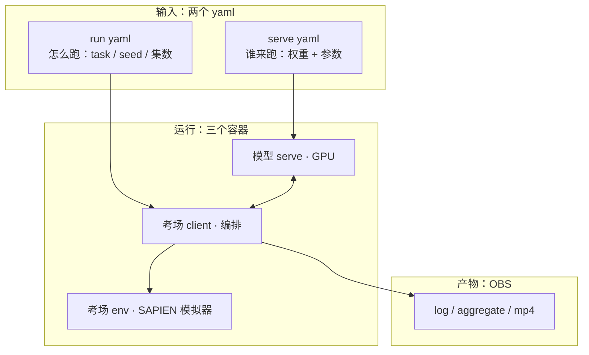

# 解剖一次跑分：grab_roller smoke 由哪几块组成

> 目标：指着 quickstart 刚跑完的那一轮，说出每块东西是什么、在哪、长啥样。
> 时间：15 分钟 ｜ 前置：读完 `quickstart` ｜ 三角色必读（伙伴照着写、运维排障对照、复现者看格式）。
> 你将得到：一张"一次跑分 = 2 yaml + 1 次运行 + 3 样产物"的地图，后面三条线都引用它。

一次跑分就是这五样，多一样少一样都不行：



## 第一块：serve yaml（谁来跑）

即 `configs/serve-robotwin-cogact.yaml` 全文（16 行，CI 实际用 snapshot 生成的
`serve-robotwin-local.yaml`，只差 `model_path` 一行）：

照抄官方 `db_cogact/robotwin2.yaml`，只换了 `model_path` 按 task 分头——DB-CogACT 官方原生+harness 两条路全通，所以零模型代码（见 quickstart 链路全景）。

```yaml
script: "src/vla_eval/model_servers/dexbotic/cogact.py"   # 跑哪个 server 实现（不动）
args:
  model_path: Dexmal/robotwin-db-cogact/grab_roller       # ★哪个权重（本轮 grab_roller 头）
  port: 8000                                              # serve 端口（不动）
  chunk_size: 16                                          # ★一次几个动作（RobotWin 16）
  camera_keys: '["head_camera", "left_camera", "right_camera"]'  # ★哪几个相机
  use_text_template: false                                # RobotWin false
```

> **原理**：这个文件回答"把什么权重以什么参数跑起来"——上游"接一次模型"
> 三件套里的"哪一个"（另两件：server 实现=哪一族，权重=字节）。本轮 smoke 的全部
> 模型侧信息就这 16 行；01 里你要写的就是它的同构文件，把模型换成你的。

## 第二块：run yaml（怎么跑）

即 `configs/run-robotwin-smoke.yaml` 全文（照抄官方 `benchmarks/robotwin/eval.yaml`，只换 SWR 镜像 + 加 `timeout: 600`）：

```yaml
server:
  url: "ws://localhost:8000"      # 连哪个 serve（dispatch 覆盖，不动）
  timeout: 600.0

docker:
  image: swr.cn-north-4.myhuaweicloud.com/link-seek/vla-eval-robotwin:0.8.0

output_dir: "./results"

benchmarks:
  - benchmark: "vla_eval.benchmarks.robotwin.benchmark:RoboTwinBenchmark"
    episodes_per_task: 1          # ★smoke=1，全量=50（就差这一行）
    params:
      task_name: grab_roller      # ★双臂协作抓滚筒（任务细节见[官方任务页](https://robotwin-platform.github.io/doc/tasks/grab_roller.html)）；最稳最快，smoke 与全量首 task
      task_config: demo_clean     # ★Easy 条件（Hard 用 demo_randomized，待补）
      seed: 0
      instruction_type: seen
      test_num: 1                 # ★smoke=1，全量=50
      skip_expert_check: true     # ★smoke 跳专家校验，全量打开
    action_dim: 14                # ★双臂关节维度
```

> **原理**：smoke 和全量是**同一个文件**，只差 `episodes_per_task/test_num/
> skip_expert_check` 三处——"先 smoke 后全量"没有新变量，这就是省卡钱的全部含义。
> 03 排期参数（tasks/episodes/shards/video）就是改这几处。

## 第三块：产物（落 OBS 的三样）

`<obs_prefix>/robotwin-smoke/`（flat 打平）：

1. **`robotwin-smoke.log`**：client 侧全日志，尾部看两行——`serve UP`（serve 活了）
 和 `smoke_exit=0` + 1/1（链路通了）。排障先看尾 15 行，见 02。
2. **aggregate JSON**：长这样（实物见 `docs/reports/cogact_robotwin-grab_roller-x50.json`，
 下例为 smoke 口径示意）：

```json
{
  "model": "Dexmal/robotwin-db-cogact (grab_roller 头)",
  "task": "robotwin-grab_roller-smoke",
  "mean_success": 1.0,
  "n": 1,
  "errors": 0,
  "versions": {"harness": "v0.8.0", "benchmark_image": "vla-eval-robotwin:0.8.0-ee-slim"},
  "machine": "V100",
  "seeds": "seed 0，skip_expert_check=true",
  "artifacts": "<OBS 链接>"
}
```

3. **mp4 录像**：每 ep 一个（smoke 强制开）。出 0 分时亲眼看——log 只能告诉你
 0 还是 1，录像告诉你**怎么 0 的**（口径错配的黑图/乱动 vs 模型真没做出来）。

> **原理**：harness 不发明分数——env 按任务代码判（`check_success`），client 透传，
> export 落盘。`error`（infra/坏种子抛异常，单列）vs `fail`（模型没做出来，记 0）
> 在这里分家；0/30 全 ERROR 时 exit code 照样 0，看分不看日志会误判。

## 地图收束：后面三条线各拿走什么

* 伙伴（01）：照第一块的样子写你的 serve yaml，★项换成你的口径。
* 运维（operator/01）：开跑改的是第二块那几处参数，排障看的是第三块的 log 尾。
* 看分数（03）：读的是第三块的 aggregate + mp4，对的是第二块的 task_config/seed。
