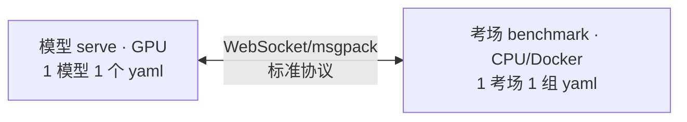

# 评测教程：从哪里开始

> 版本唯一真源：`docker/versions.yaml`（harness 全系 `0.8.0`）。本文只给路线，不钉版本号。

## 为什么要这么评（先看这段，再决定要不要往下读）

伙伴自测的分数互相不可比，三处不同：**训练口径**不同（per-suite 微调 vs 通用
单 checkpoint，RoboTwin 2.0 论文 §4.3 [Table 3（Evaluating the Impact of RoboTwin 2.0 on Policy Robustness）](https://arxiv.org/abs/2506.18088)里，换训练口径相对差 30%（RDT 18.8%→24.8%，绝对 6pp））、**环境栈**不同（GPU/精度/镜像/种子，
栈差异对照里一动 6~97pp（镜像差 6pp，精度差 97pp））、**判分标尺**不同（各榜成功率/链长各说各话）。
横向评测就是把这三处全固定，只让模型变——这套教程的每一篇，都是在固定其中一处：
quickstart 证明尺子可信，01~03 交出可比的数，Hard 与训练固定是评测阶段的事。

## 为什么我们来做

1. **有需求**：伙伴选型要的是第三方可信分，不是论文数——无论别人做还是我们做，
最后都要有人做。需求在我们手里，所以只能是我们牵头。
2. **我们代表第三方客观**：不训模型、不卖模型，只出数。上游 leaderboard 只聚合
论文数、不独立验证（上游论文 Limitations 原话）。独立第三方 + 方法数据
全披露 + 可复现——这个生态位是空的，我们站上去。权威不是宣称来的，是 Hard 与
训练对照跑出来之后挣的，在那之前只谈独立，不谈权威。
3. **有能力**：横向对比要三种能力——跑得起来（执行）、比得可信（方法）、尺子不准能修（保真），我们全有：V100 离线链路现成（执行）；栈差异对照、披露清单、排名规则（方法，
对照已补，清单与规则在跑）；harness contributor，能改尺子（[#168](https://github.com/allenai/vla-evaluation-harness/pull/168) 已合入上游主线，
[#169](https://github.com/allenai/vla-evaluation-harness/issues/169) 当天拿到维护者钥匙）——别人纯用遇到尺子 bug 只能绕（EE 通路断裂、SmolVLA
维度错位），我们修进去。路线对比（目标=多模型×多榜横向可比）：

## 你是谁？走哪条路？

| 你是 | 目标 | 走法 | 时间 |
|---|---|---|---|
| 伙伴（来评测模型） | 有训好的模型要交，拿分数 | `quickstart` → `partner/01-serve-yaml`（含 smoke）→ `02-full-and-report` | smoke 0.5~2h，全量 3~7h/task |
| 运维（开卡保链路） | 让 V100 离线跑起来 | `quickstart` → `operator/01-system-and-run` | 20 分钟，按需查 |
| 复现者（对照分数） | 看懂一张分数怎么来的 | `quickstart` → `explanation/` → `reference/` | 30min |

三条路都从同一篇开始：[quickstart.md](https://github.com/link-seek/partner-vla-eval/blob/main/docs/tutorial/quickstart.md)（RobotWin smoke，grab_roller×1ep，只验链路不计分）。

## 核心架构

模型和考场互相不知对方存在，中间是标准协议——N 个模型 × M 个考场只接 N+M 次。
各考场依赖装不到一起，所以每个考场进自己的 Docker 镜像。逻辑二分，部署三分：考场落地时拆成 client（编排）+ env（SAPIEN 本体）——仿真器独占进程、可多开，crash 不连累编排（见 [anatomy.md](https://github.com/link-seek/partner-vla-eval/blob/main/docs/tutorial/anatomy.md) 三容器图）。本教程只讲 RobotWin（双臂基线）。LIBERO/CALVIN 为规划接入方向，见下表。

## 关键术语

* **考场**：一个 benchmark（环境+任务集+判分规则）。
* **smoke**：1 task×1ep，只验链路。**全量**：1 task×50ep（`test_num` 官方口径），计分。
* **主指标**：harness 只透传 benchmark 原生规则再平均。RobotWin 是单 ep 二值平均；多榜指标（CALVIN 平均链长等）待接入后展开。跨榜只并列展示，不加权总分。
* **训练口径**（多榜通则，LIBERO 为例）：成功率还依赖训练口径——上游复现多为 per-suite 微调 checkpoint，
 与通用单 checkpoint 不可比。比 LIBERO 必须同时对齐 checkpoint 与训练说明
 （见 `partner/01` 表单）。

## 覆盖：现状与规划

| 方向 | 考场 | 状态 |
|---|---|---|---|
| 现状 | RobotWin 2.0（双臂基线，DB-CogACT 按 task 分头） | smoke + 4 轮出分（见 quickstart 对照表） |
| 规划接入 | LIBERO（单臂短程）/ CALVIN（单臂长程） | 规划中 |
| 规划位 | DuoBench / RMBench / 真机 | 先 smoke，后放 |

## 我们现在在哪一步（评价 vs 评测，必读以免误读分数）

* **评价（已完成）：跑出可信的分数**——链路跑通、RobotWin smoke 全绿、四轮出分、
 栈差异对照、披露清单。回答"这个配置下多少分"，**不回答"哪个基模强"**。
* **评测（未开始）：可比、可解释的基模比较**——固定数据和训练方式（如官方 §4.5 范式：
 单 task 50 demos 微调 → Easy/Hard 各 100 rollouts），横向比较伙伴基模在同训练
 口径下的成功率（[官方 Table 3](https://arxiv.org/abs/2506.18088)：同一模型×三种训练口径比成功率，即用不同微调方法评价基模优劣）。当前阶段只能跑出评分，做不到这一步。这需要训练侧立项（数据+ recipe +算力，
 见 [99-audit.md](https://github.com/link-seek/partner-vla-eval/blob/main/docs/tutorial/old/99-audit.md) 第 5 条"另立项 finetune"），是新工程，不是本教程的范围。

没有阶段一，可比的阶段二不存在（口径一动几十分点）；但只有阶段一时，
任何"基模排名"式解读都是错的。

## 文档地图（四分法）

* **Tutorial（学）**：`quickstart` + `partner/` —— 跟着跑，保证绿。
* **How-to（做）**：`operator/` —— 系统分工、开跑、排障，按需查。
* **Reference（查）**：`reference/` —— 口径映射表、镜像 tag、15 条排障表。主线不展开，只给链接。
* **Explanation（懂）**：`explanation/` —— 栈差异对照、精度断崖、种子效应。有结论才进榜，主线一句话带过。

旧稿归档在 [old/](https://github.com/link-seek/partner-vla-eval/tree/main/docs/tutorial/old)（只读，迁移映射见 [README.md](https://github.com/link-seek/partner-vla-eval/blob/main/docs/tutorial/old/README.md)）。版本历史与口径偏离见 `changelog.md`（待写），正文不写版本号。
