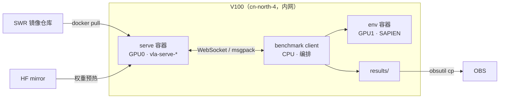

# 运维：这套系统怎么跑

> 目标：看懂三机分工，能独立开一轮、收产物、排掉常见故障。
> 时间：20 分钟 ｜ 前置：`quickstart`。
> 你将得到：一轮完整产物 + 排障路径。

## 系统长什么样

三机分工，铁律是**下载只能发生在有外网的地方**：

| 机器 | 网络 | 只干 |
|---|---|---|
| 外网构建机（临时） | 外网 | 打镜像 → SWR；一次性下载；不跑生产 |
| hw21 常驻机 | 近内网 | hcloud 开关 V100；跳板 |
| V100（cn-north-4） | 近内网 | 离线跑：SWR 拉镜像、mirror 拖权重、`UV_OFFLINE=1` |

V100 上禁止：`pip/uv` 装包、`git clone`、HF 直连、ghcr 拉取。缺东西回外网机烘进镜像，不要现场装。

版本真源是 `docker/versions.yaml`。镜像在 SWR `swr.cn-north-4.myhuaweicloud.com/link-seek/`：RobotWin 生产 tag `vla-eval-robotwin:0.8.0-ee-slim`，serve 按模型 `vla-serve-<名>:0.8.0`，预热用 `vla-verify:0.1`。不要用 `latest`。

运行链路：

serve 独占卡 0，分片/渲染放卡 1；同一时刻只跑一个 GPU job，不并发抢卡。client 和 env 来自同一个 benchmark 镜像。

## 镜像从哪来（为什么不是官方原图）

官方 RobotWin 镜像约 28GB（带资产、nvcc、源码），V100 只有内网、不能现场装包。我们在外网构建机重打成生产镜像，V100 只负责拉：

| 镜像 | 作用 | 怎么来的 |
|---|---|---|
| `vla-eval-robotwin:0.8.0-ee-slim`（~11GB） | benchmark：client + env 共用 | 官方 base + RoboTwin 源码；slim 三刀（资产外置 / nvcc 多阶段 / curobo 源码清）+ EE 从上游主线烘入 |
| `vla-serve-<模型>:0.8.0` | 模型 serve | 官方 server + 该族依赖烘入 + uv 暖缓存；权重不进镜像 |
| `vla-payload:<sha>`（几 MB） | V100 执行代码 | 本仓 `scripts/` + `configs/` + `versions.yaml` 打包，免 checkout |
| `vla-verify:0.1` | 权重预热 / 下载杂活 | 工具镜像，`hf-download` 钉别名 |

`vla-eval-robotwin:0.8.0`（28GB 原版）保留作回滚位，不跑生产。

**运行是三个容器、两个主镜像**：serve（卡 0）+ client（编排）+ env（SAPIEN，卡 1）；client 和 env 都来自 benchmark 镜像，只是角色不同。别把它理解成三个镜像。

换版流程：改 `docker/versions.yaml` 的 pin → 外网构建机重打 → 推 SWR → V100 拉新 tag。V100 上永远不打镜像、不装包。

## 怎么开一轮

1. **定版本**：对 `docker/versions.yaml` 选 tag，记下 benchmark 和 serve 两个 tag。
2. **开卡**：`hcloud ECS BatchStartServers`，轮询 `ListServersDetails` 到 `ACTIVE`（约 12 分钟）。
3. **拿代码**：V100 不能 clone；用 payload 镜像 `docker create` + `docker cp` 取出 `scripts/`、`configs/`。
4. **登录 SWR + 拉镜像**：AK/SK 派生登录，拉 benchmark、serve、verify 三个镜像。
5. **预热权重**：verify 镜像跑 `hf-download`（`HF_ENDPOINT` 走 mirror，带 token）。
6. **起 serve**：`docker run -d --gpus device=0 ... vla-eval serve -c <serve.yaml>`，等 8000 端口通（脚本内 3 次重试）。
7. **跑 + 收**：smoke 跑 `bash scripts/ci_robotwin.sh`；全量跑 `bash scripts/ci_robotwin_full.sh`。结果在 `results/`，`obsutil cp` 传到 `<obs_prefix>/robotwin-<smoke|full>/`。

全量常用变量（脚本当前默认值）：

| 变量 | 含义 | 默认 |
|---|---|---|
| `RW_TASKS` | 逗号分隔的 task | 首块 5 个 |
| `RW_EPISODES` | 每 task 集数 | 50 |
| `RW_SHARDS` | 分片数 | qpos 8 / ee 4 |
| `RW_VIDEO` | 1 = 录像 | 0 |
| `SERVE_IMAGE` | serve 镜像 | `vla-serve-cogact:0.8.0` |
| `RW_BENCH_TAG` | benchmark tag | 0.8.0 |

脚本默认参考模型还在收敛（CogACT / X-VLA），换模型时用 `SERVE_IMAGE` + 对应 serve yaml 覆盖，不要改脚本。

开跑前必做：OBS 写探针（脚本已内置，失败不烧卡）。跑完必做：确认关机。

## 出问题怎么解决

| 症状 | 先看 | 处理 |
|---|---|---|
| 开机 15 分钟不到 ACTIVE | hcloud 返回、配额、安全组 | 重试 `BatchStartServers`；看错误码；确认 region |
| serve 起不来 | `results/serve-debug-attempt*.log`、端口 8000、HF 401、路径三段式 | 开权限 / 改本地路径 / 重试；3 次失败停 |
| 跑满但全 0 分 | `Spec mismatch`、`action_type`、`camera_keys` | 改口径，重跑 smoke |
| 全 ERROR 但 exit 0 | `errors` 列、OOM、坏种子 | 先看 errors；OOM 降分片；坏种子单列重跑 |
| OBS 没结果 | prefix 格式、AK/SK、endpoint；upload 的 `\|\| true` 会吞错 | 先跑写探针；修地址后重传 |
| 磁盘满 | `docker system df`、HF 缓存 | prune 旧镜像 / 清缓存 |
| 跑完没关机 | stop 日志 | 手动 hcloud stop；确认 `always` 生效 |

日志位置：`results/ci.log`、`results/robotwin-smoke.log`、`results/cogact-serve.log`，全量在 `results/<chunk>/shard.log`。

## 检查点

- [ ] 开跑前写探针绿？地址错就别烧卡。
- [ ] serve UP 且 `smoke_exit=0`？
- [ ] 先看 `errors`，再看 `mean_success`？
- [ ] 产物进 OBS，且本机已关机？

## 原理

* **为什么下载只能在外网机**：V100 出境被限速/不通，现场装包 = 不可复现。
* **为什么 serve 独占卡 0**：SAPIEN 多上下文抢卡会 hang；分片放卡 1 是实测切法。
* **为什么先 smoke**：1 task×1ep 把权重、serve、口径、落盘一次验掉，比全量便宜两个数量级。
