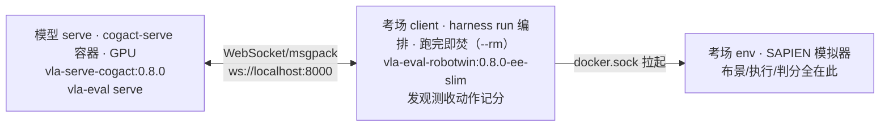

# Quickstart：跑通第一条双臂链路

> 目标：跑通 RobotWin smoke（grab_roller×1ep），亲眼看到双臂链路是绿的。
> 时间：操作 10 分钟 + 等卡 0.5~2 小时 ｜ 前置：无（不用懂镜像，不用装依赖）
> 你将得到：`smoke_exit=0` + OBS 落盘 + 一次 spec 对齐确认。

## 链路全景



三容器：模型 serve（权重变服务）←→ 考场 client（发观测收动作记分）→ 经 docker.sock 拉起考场 env（SAPIEN 模拟器，判分在此）。详见 [anatomy.md](https://github.com/link-seek/partner-vla-eval/blob/main/docs/tutorial/anatomy.md)。

## 操作

1. 在 GitHub 点 dispatch：在本仓 Actions → `RobotWin Smoke (DB-CogACT)` →
 `Run workflow`。无参数，直接点绿钮。之后全自动：hw21 开机 → V100 跑
 `scripts/ci_robotwin.sh`（5 步）→ 跑完自动关机。单卡串行，前有队列就排队。

2. 等 5 步跑完。V100 日志里看到下面 6 行即正常：

```text
[2/5] bench + serve 镜像 (SWR 内网拉取)
[3/5] verify 镜像
[4/5] 预热 DB-CogACT 权重 (grab_roller 头, mirror, 带重试)
[4b/5] 启动 DB-CogACT serve (GPU0, 后台) ... serve UP
[5/5] 跑 RobotWin smoke (grab_roller 1ep, 用 robotwin 镜像当 client)
smoke_exit=0
```

3. 到 OBS 收产物：`<obs_prefix>/robotwin-smoke/`（默认
 `obs://so101-sim-pipeline/eval/robotwin-smoke/`，flat 打平无子目录；
 dispatch 自填了前缀就去自填的地址）。对着检查点打勾。

## 检查点

- [ ] `robotwin-smoke.log` 尾部 1/1（只验链路，不计分）。
- [ ] `cogact-serve.log`：serve 端完整日志。
- [ ] 录像 mp4：出 0 分时亲眼看，不要只看数字。
- [ ] `serve UP` 在探测内出现？3 次重试都起不来，先看 serve 尾日志
 （已自动存 `results/serve-debug-attempt*.log`），不要先怀疑 benchmark。
- [ ] 日志头 20 行无 `Spec mismatch`？有 → **停手**，先对
 [06-model-onboarding.md](https://github.com/link-seek/partner-vla-eval/blob/main/docs/tutorial/old/06-model-onboarding.md) 口径映射表，不要烧卡硬跑。
- [ ] 权重预热 `Xet 401`？预热传 token + `HF_HUB_DISABLE_XET=1`（脚本里已有）。
 修不好的完整 15 条表在 [08-troubleshooting.md](https://github.com/link-seek/partner-vla-eval/blob/main/docs/tutorial/old/08-troubleshooting.md)（将迁入 `reference/error-codes.md`）。

## 原理

* **解耦**：模型和考场互相不知对方存在（上游论文 §II-A）。模型只实现
 `predict(观测)→动作`，考场只实现 `reset/step/判分`，N×M 接成 N+M；
 各考场依赖装不到一起，所以每个考场进自己的 Docker 镜像。
* **零 checkout**：V100 平时关机（省卡钱），开机关机走 hw21 调华为云内网 API。
 V100 几乎没有外网，代码经 `vla-payload` 镜像从 SWR 内网取，不走 GitHub。
 **下载只能发生在有外网处**，这是全仓铁律。
* **权重不进镜像**：15GB/头传不动。serve 镜像只烘依赖，权重走 mirror 下到
 V100 盘缓存永久有效；运行时 `UV_OFFLINE=1`，缺东西直接失败，不许现场装。
* **预热与探测**：`hf-download` 先下好权重（Xet 要 token）；7B 加载分钟级，
 120 轮×10 秒上限是算过的；3 次重试 cover 冷启动偶发 CUDA 初始化失败。
* **本地路径**：`from_pretrained` 不认 `repo/subdir` 三段式，CI 先 snapshot 再
 `sed` 生成 `serve-robotwin-local.yaml`；手写三段式必 `HFValidationError`。
* **smoke 的定义**：`test_num=1` + `skip_expert_check=true`。与全量同一套配置，
 只差集数——smoke 绿了，全量没有新变量，这就是省卡钱的全部含义。
* **error≠fail**：`fail` 模型没做出来；`error` 是 infra/坏种子抛异常，单列。
 0/30 全 ERROR 时 exit code 照样 0，看分不看日志会误判（精度断崖的教训）。
* **spec 是熔断器**：episode 起点自动比对口径，EE 当关节喂则硬截 `act[:14]`——
 400 步跑满全 0 分零异常。唯一的例外是 advisory 级 warning（X-VLA `ee_pose`
 未声明但动作照通）。

## 下一步（三选一）

* 来评测模型（手里有训好的模型要交上来，才需细看）：去 [partner/01-serve-yaml.md](https://github.com/link-seek/partner-vla-eval/blob/main/docs/tutorial/partner/01-serve-yaml.md)，
 按 01→02→03 顺序读完（配准交付 → smoke → 全量拿分；不教训模型）。
* 开卡保链路：去 `operator/01-machines-ci.md`（待写，先看 [04-machines-network.md](https://github.com/link-seek/partner-vla-eval/blob/main/docs/tutorial/old/04-machines-network.md)）。
* 只看分数：RobotWin 四轮对照（校验种子，零 error 即有效；单榜 % 口径）。
 官方范式（论文 §4.5）本来就是**单 task 微调后测 Easy/Hard**，报的是 few-shot
 adaptation + robustness（Hard 落差）——我们的分头评测与官方范式一致，
 差的是：100→50 rollouts、只有 Easy（demo_clean）缺 Hard、头的训练数据未知。
 先对 Easy，再补 Hard。

| task | 我们 | 官称 |
|---|---|---|
| grab_roller | 92%（46/50） | 89% |
| adjust_bottle | 100%（35/35 有效，15 坏种已剔） | 99% |
| place_empty_cup | 16%（8/50） | 28% |
| place_phone_stand | 16%（8/50） | 18% |

差 10pp 以内判同档（n=50 噪声带约 ±6pp）；跨榜不比大小（多榜指标待接入后展开）。
完整排名规则与披露清单在 [03-full-and-report.md](https://github.com/link-seek/partner-vla-eval/blob/main/docs/tutorial/partner/03-full-and-report.md)，栈差异对照在 `explanation/`。
