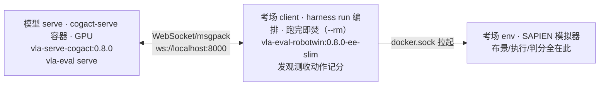

# Quickstart：跑通第一条双臂链路

> 目标：跑通 RobotWin smoke（grab_roller×1ep），亲眼看到双臂链路是绿的。
> 时间：操作 10 分钟 + 等卡 0.5~2 小时 ｜ 前置：无（不用懂镜像，不用装依赖）
> 你将得到：`smoke_exit=0` + `results/` 落盘 + 一次 spec 对齐确认。
> 读法：只想跑通，跟`步骤`走；想明白为什么，看每步后的 `原理`。

## 链路全景（30 秒看懂在干什么）



> **原理**：模型和考场互相不知对方存在（上游论文 §II-A，arXiv:2603.13966）。
> 模型只实现 `predict(观测)→动作`，考场只实现 `reset/step/判分`，中间是标准协议。
> 这样 N 个模型 × M 个考场只需接 N+M 次，不用每家重写评测；各考场依赖
> （Python 版本、仿真器）装不到一起，所以每个考场进自己的 Docker 镜像。
> 落到 V100 上数容器是 3 个：serve 和 client 各一个（SWR 烘焙镜像，host 网络），
> client 挂 `/var/run/docker.sock` 再拉起真正跑 SAPIEN 的 env 容器——`docker ps`
> 可验证。上游本地开发时 serve 可直接跑宿主（`uv run`），V100 离线跑不动宿主依赖，
> 所以 serve 也进容器（依赖全烘 + `UV_OFFLINE=1`）。

## 步骤一：在 GitHub 点 dispatch（10 分钟操作就这一件）

进本仓 Actions → `RobotWin Smoke (DB-CogACT)` → `Run workflow`。无参数，直接点绿钮。
之后全自动：hw21 开机 → V100 跑 `scripts/ci_robotwin.sh`（5 步）→ 跑完自动关机。
单卡串行，前有队列就排队。

> **原理**：V100 平时是关机的（省卡钱），开机关机走 hw21 常驻机调华为云内网 API——
> V100 关着时也能叫醒。V100 几乎没有外网，所以 Runner 零 checkout：代码经
> `vla-payload` 镜像从 SWR 内网取，不走 GitHub（HW21 到 GitHub 限速 ~8KB/s，
> checkout 必超时）。**下载只能发生在有外网处**，这是全仓铁律。

## 步骤二：等 5 步跑完（读懂每步在干什么）

```text
[2/5] bench + serve 镜像 (SWR 内网拉取)     bench 用 0.8.0-ee-slim（唯一生产），serve 用 vla-serve-cogact:0.8.0
[3/5] verify 镜像                            只做权重预热/杂活的小镜像
[4/5] 预热 DB-CogACT 权重 (grab_roller 头)   mirror 直下 + 3 次重试，落 V100 盘缓存
[4b/5] 启动 serve ... serve UP               120 轮探测，3 次重试
[5/5] 跑 smoke (grab_roller 1ep)             录像常开（RW_VIDEO=1）
```

> **原理·权重不进镜像**：权重 15GB/头，烘进镜像传不动。serve 镜像只烘依赖
> （torch cu126、transformers、harness 源码+补丁、uv 预热缓存），权重走国内
> mirror 下到 V100 盘，缓存永久有效。运行时 `UV_OFFLINE=1`：离线是硬约束，
> 缺东西直接失败，不许现场 `pip install`（现场装=不可复现）。
> **原理·预热**：`hf-download` 先把权重下好，serve 启动才不至于边加载边超时；
> 权重走 Xet 协议，mirror 直连要 token（见下卡点）。
> **原理·serve 探测**：7B 权重加载是分钟级，120 轮×10 秒≈20 分钟上限是算过的，
> 不是拍脑袋。3 次重试是因为冷启动偶发 CUDA 初始化失败，重试比排错便宜。
> **原理·本地路径**：`from_pretrained` 不认 `repo/subdir` 三段式（只认单仓或本地
> 路径），所以 CI 先 snapshot 再 `sed` 生成 `serve-robotwin-local.yaml`。
> 手写三段式路径 serve 必起不来（`HFValidationError`，见 `old/08-troubleshooting.md` 第 2 条）。

## 步骤三：到 OBS 收产物，对照打勾

主路去 OBS：`<obs_prefix>/robotwin-smoke/`（默认
`obs://so101-sim-pipeline/eval/robotwin-smoke/`，flat 打平无子目录；
dispatch 自填了前缀就去自填的地址）。

- [ ] `robotwin-smoke.log`：尾部 1/1（只验链路，不计分）。
- [ ] `cogact-serve.log`：serve 端完整日志。
- [ ] 录像 mp4：出 0 分时亲眼看，不要只看数字。

> **原理·smoke 的定义**：`test_num=1` + `skip_expert_check=true`。专家校验是开跑前
> 用官方 planner 逐种子验证"这局求解器能解"，50ep 全量必须开（排坏种）；smoke
> 只验链路，跳过它省十几分钟。全量就是同一套配置把 `test_num` 从 1 调到 50，
> smoke 绿了，全量没有新变量——这就是"先 smoke 后全量省卡钱"的全部含义。
> **原理·error≠fail**：`fail` 是模型没做出来（记 0 分）；`error` 是 infra/坏种子
> 抛异常，单列不怪模型。反直觉点：0/30 全 ERROR 时 exit code 照样 0，
> 看分不看日志会误判（B 精度断崖的教训）。

## 检查点（出错先看这里，不过再烧卡）

- [ ] `serve UP` 在探测内出现？3 次重试都起不来先看 serve 尾日志
 （已自动存 `results/serve-debug-attempt*.log`），不要先怀疑 benchmark。
- [ ] 日志头 20 行无 `Spec mismatch`？有 → **停手**。
- [ ] `smoke_exit=0` 且 1/1？

> **原理·spec 是熔断器**：episode 起点 harness 自动比对观测/动作口径
> （维度、关节 vs 末端、相机名），错配直接打 warning。最典型的死法：EE 口径
> 的动作当关节喂，benchmark 硬截 `act[:14]` 当关节执行——400 步跑满，全 0 分，
> 零异常。看到 warning 先对 `old/06-model-onboarding.md` 口径映射表，不要烧卡硬跑。
> 唯一的例外是 advisory 级 warning（X-VLA 的 `ee_pose` 未声明但动作照通），
> 真拦路的是 unknown kwarg 类错误。

## 常见卡点（只记一个，其余进 reference）

> 权重预热 `Xet 401`？权重走 Xet，mirror 直连要 token：预热传 token +
> `HF_HUB_DISABLE_XET=1`（脚本里已有）。修不好的完整 15 条表在
> `old/08-troubleshooting.md`（将迁入 `reference/error-codes.md`）。

## 下一步

* 伙伴交模型：去 `partner/01-serve-yaml.md` —— 交权重地址 + 一个 serve yaml
 （照 `partner-onboarding.md` 表单填，不知道的空着；按 task 分头的逐个列出）。
* 运维保链路：去 `operator/01-machines-ci.md` —— 开关机、串行队列、runner 掉了怎么修。
* 想先看分数长什么样：RobotWin 四轮对照（校验种子，零 error 即有效；单榜 % 口径）。
  官方范式（论文 §4.5）本来就是**单 task 微调后测 Easy/Hard**，报的是 few-shot
  adaptation + robustness（Hard 落差），不是单一 checkpoint 的通用能力——我们的分头
  评测与官方范式一致，差的是：100→50 rollouts、只有 Easy（demo_clean）缺 Hard、
  头的训练数据未知。先对 Easy，再补 Hard。

| task | 我们 | 官称 |
|---|---|---|
| grab_roller | 92%（46/50） | 89% |
| adjust_bottle | 100%（35/35 有效，15 坏种已剔） | 99% |
| place_empty_cup | 16%（8/50） | 28% |
| place_phone_stand | 16%（8/50） | 18% |

差 10pp 以内判同档（n=50 噪声带约 ±6pp）；CALVIN 另看平均链长，跨榜不比大小。
完整排名规则与披露清单在 `partner/03-full-and-report.md`，栈差异 A-D 在 `explanation/`。
